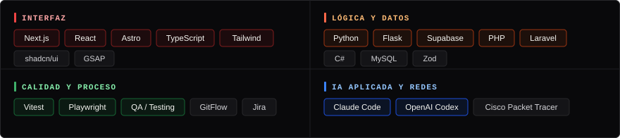

 

  
  
  

---

### `01` / Proyectos

Gran parte de mi trabajo vive en repositorios privados (consultorías TI, tesis y productos en desarrollo). Algunos proyectos públicos y en producción:

| Proyecto | Estado | Descripción | Stack |
| :--- | :--- | :--- | :--- |
| **[APEX Fitness](https://www.apexfitness.cl/)** | `Producción` | Plataforma interna de uso diario para gimnasio: clientes, planes, inventario, acceso QR, rutinas y evaluaciones nutricionales. | `Next.js` `TypeScript` `Supabase` `shadcn/ui` |
| **Vueltito** | `En construcción` | Punto de venta e inventario para almacenes de barrio con tres interfaces (caja, dueño y admin SaaS) y soporte offline. | `Next.js` `TypeScript` `Supabase` `Zod` |
| **[Legacy Auto Studio](https://legayautostudio.vercel.app/)** | `En construcción` | Sitio web para estudio de detailing automotriz en Antofagasta, con galería real y contacto directo. | `Astro` `TypeScript` `GSAP` `Lenis` |
| **[Grúas Bully](https://gruasbully.vercel.app/)** | `En construcción` | Landing de servicio de grúa 24/7 optimizada para solicitudes rápidas por WhatsApp. | `Astro` `TypeScript` `GSAP` |

---

### `02` / Recorrido

- **Consultorías TI (Prácticas y Tesis):** Diseño y desarrollo de plataformas web reales con **Next.js, TypeScript, Supabase y PHP**, combinando arquitectura de datos, QA y flujos con IA.
- **Ayudantía de Redes de Computadores (UCN):** Clases prácticas y laboratorios de topologías, VLAN, OSPF, ACL y NAT en **Cisco Packet Tracer**.
- **Bootcamp BHP / Coding Dojo Latam:** Certificación Full Stack en **Python y Flask** (Cinturón Negro).

---

### `03` / Stack

