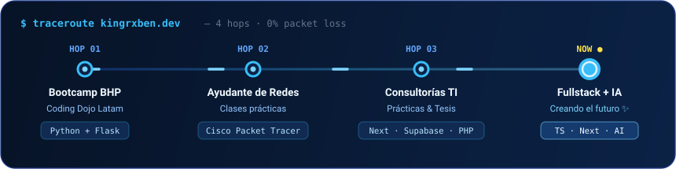

<!-- HERO BANNER ANIMADO CON NUGGET -->

  

<!-- SOCIAL BADGES -->

  
  <!-- Descomenta y agrega tus enlaces cuando quieras:
  
  
  -->

---

### 💙 Sobre mí

¡Hola! Soy **Rubén Macaya** (me dicen **Rxben**). Me considero alguien **creativo, feliz y siempre construyendo cosas nuevas**. Hoy estoy enfocado en el desarrollo **Fullstack potenciado con IA**, mezclando ingeniería práctica, diseño limpio y curiosidad constante.

> **Nota rápida:** La mayoría de mis repositorios (prácticas, tesis en consultorías TI y proyectos con IA) están en **privado 🔒**, así que este perfil resume mejor lo que construyo día a día — siempre bajo la atenta supervisión de **Nugget**, mi ninfa 🐦.

 

<!-- BENTO GRID PERSONALIZADO -->

 

### 🌐 Mi recorrido (`traceroute`)

<!-- TIMELINE ESTILO TRACEROUTE -->

- **Fullstack + IA:** Diseñando y desarrollando aplicaciones modernas integrando modelos de lenguaje, automatizaciones y flujos inteligentes.
- **Consultorías TI (Prácticas & Tesis):** Desarrollo de plataformas reales con **Next.js, TypeScript, Supabase y PHP**.
- **Ayudantía de Redes de Computadores:** Clases prácticas y laboratorios de routing, switching y topologías con **Cisco Packet Tracer**.
- **Bootcamp BHP · Coding Dojo Latam:** Formación intensiva Fullstack en **Python + Flask**.

 

### 🛠️ Stack & Herramientas

  

 

### 🐍 Actividad en modo azul

  <picture>
    <source media="(prefers-color-scheme: dark)" srcset="https://raw.githubusercontent.com/kingrxben/kingrxben/output/github-snake-blue-dark.svg" />
    <source media="(prefers-color-scheme: light)" srcset="https://raw.githubusercontent.com/kingrxben/kingrxben/output/github-snake-blue.svg" />
    
  </picture>

 

<!-- FOOTER ANIMADO -->

